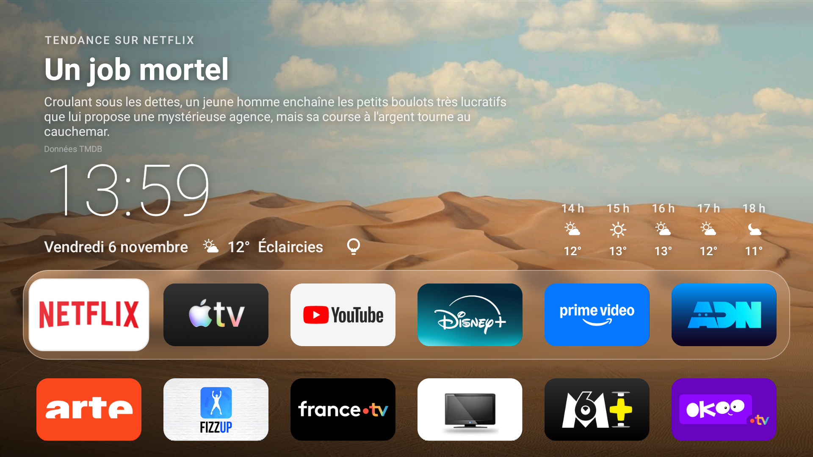
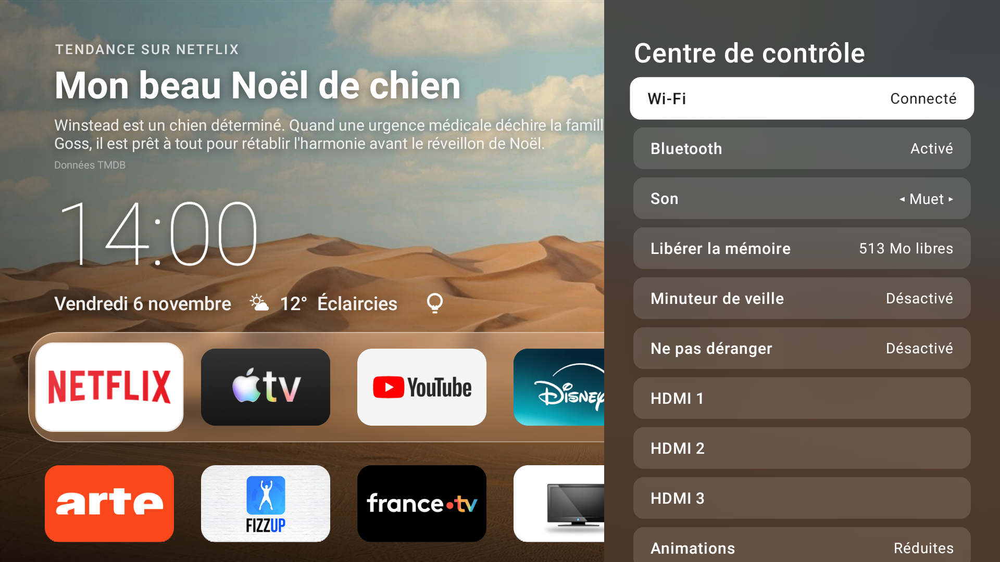
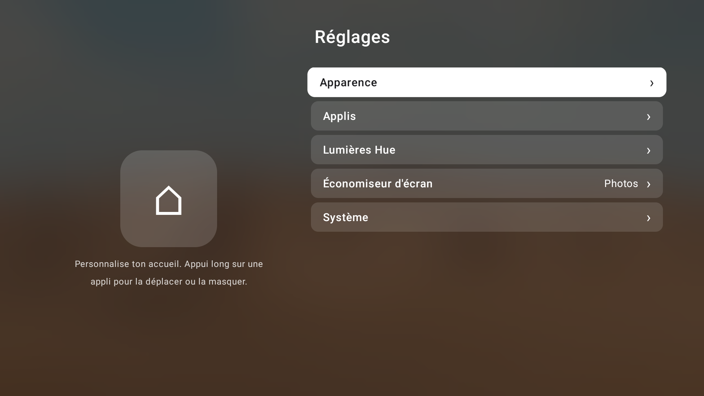
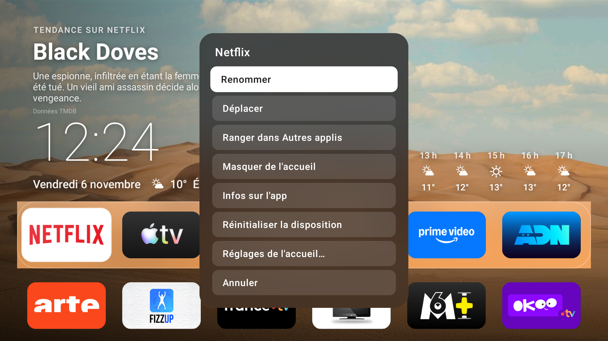

# TvHome

Un écran d'accueil **façon Apple TV** pour Android TV, pensé pour une petite TV bas de gamme
(testé sur une Edenwood / Vestel, puce MediaTek, GPU Mali-470, 1,3 Go de RAM, Android TV 11).
Écrit en Kotlin avec Compose pour TV. Le but : rester **fluide** là où le launcher d'origine rame.

<p>
  
  
</p>
<p>
  
  
</p>

## Ce que ça fait
- **Accueil** : heure, date, météo (Open-Meteo, sans clé), titre tendance de l'appli sélectionnée (TMDB, optionnel),
  grille de 6 colonnes aux mesures tvOS, capsule de verre dépoli autour de la première rangée.
- **Fond** : deux photos seulement, `nuit.jpg` et `jour.jpg`, choisies selon le lever et le coucher du soleil.
- **Menu d'une appli** (appui long sur OK) : renommer, déplacer, ranger dans « Autres applis », masquer, infos,
  réinitialiser la disposition. Les applis masquées se retrouvent dans Réglages → Applis.
- **Centre de contrôle** (icône ampoule, ou appui long sur Retour partout) : Wi-Fi, Bluetooth, son, libérer la
  mémoire, minuteur de veille, Ne pas déranger, sources HDMI, réglages rapides, lumières Philips Hue.
- **Réglages** façon tvOS (liste à droite, grande icône à gauche).
- **Filet de sécurité** : si l'accueil plante 3 fois en 5 minutes, il rend la main au launcher d'origine.

Tout le verre dépoli est **fabriqué une fois** (photo floutée précalculée). Il n'y a ni flou en direct, ni
`RenderEffect`, ni calque hors écran : le GPU de cette TV ne les supporterait pas. Voir [docs/PERFORMANCE.md](docs/PERFORMANCE.md).

## Installer
Prérequis : Android Studio (ou le SDK Android), un JDK 17 à 21, la TV en mode développeur avec le débogage réseau.

1. Cloner le dépôt, puis créer `local.properties` à la racine (ce fichier n'est jamais publié) :
   ```properties
   sdk.dir=C\:\\chemin\\vers\\Android\\Sdk
   weather.lat=48.8566
   weather.lon=2.3522
   tmdb.token=            # optionnel : jeton de lecture TMDB, vide = pas de titres tendances
   ```
2. Connecter la TV : `adb connect <IP de la TV>:5555`.
3. Installer **en release** avec le script (il précompile l'appli, ce qui change tout sur une petite TV) :
   ```powershell
   powershell -ExecutionPolicy Bypass -File deploy.ps1
   ```
   Les scripts supposent l'IP de ma TV (`192.168.1.24`) : changez `$tv` en tête de `deploy.ps1`, `bench.ps1`
   et des scripts de `bench\outils\`.
4. **Ne pas installer avec le bouton ▶ d'Android Studio** : son « Apply Changes » greffe un agent qui fait passer
   le démarrage de 0,5 s à 4 s.

### Les photos de fond
Aucune photo n'est fournie. Poussez deux images 16:9 (1280×720 suffisent) nommées `nuit.jpg` et `jour.jpg` :
```powershell
adb shell mkdir -p /sdcard/Android/data/fr.alban.tvhome/files/wallpapers
adb push nuit.jpg /sdcard/Android/data/fr.alban.tvhome/files/wallpapers/nuit.jpg
adb push jour.jpg /sdcard/Android/data/fr.alban.tvhome/files/wallpapers/jour.jpg
```

### En faire l'écran d'accueil
```
adb shell cmd package set-home-activity fr.alban.tvhome/.MainActivity
adb shell pm disable-user --user 0 com.google.android.tvlauncher
```
Retour au launcher d'origine si besoin : `adb shell pm enable com.google.android.tvlauncher`.
**À vos risques** : désactiver le launcher d'origine change le comportement de la TV. Gardez la ligne de secours
ci-dessus sous la main.

### Raccourci « Retour long »
Réglages → Système → « Appui long sur Retour » active un service d'accessibilité (via l'ADB local de la TV).
Il ne lit aucun écran ni texte : il ne voit que les touches de la télécommande.

## Mesurer
`bench.ps1` redémarre la TV, navigue seule et relève les images ratées et le 99e percentile
(`dumpsys gfxinfo`). Détails et pièges dans [docs/PERFORMANCE.md](docs/PERFORMANCE.md).

## Crédits et licence
Code sous licence **Apache 2.0** (voir [LICENSE](LICENSE) et [NOTICE](NOTICE)).

Une partie des idées et des mesures vient de
[tvOS Launcher](https://github.com/techgenius1/tvos-launcher) (techgenius1, Apache 2.0) : mesures tvOS 26 de la
grille, disposition des réglages, contenu du centre de contrôle, renommer / dossier « Autres applis ».
Le code est réécrit en Kotlin / Compose ; les fichiers concernés portent le commentaire
« Adapté de tvOS Launcher (techgenius1), Apache 2.0 ».

Les photos de fond d'origine du projet (Unsplash) ne sont pas incluses. TMDB : « Ce produit utilise l'API TMDB
mais n'est ni approuvé ni certifié par TMDB ».
